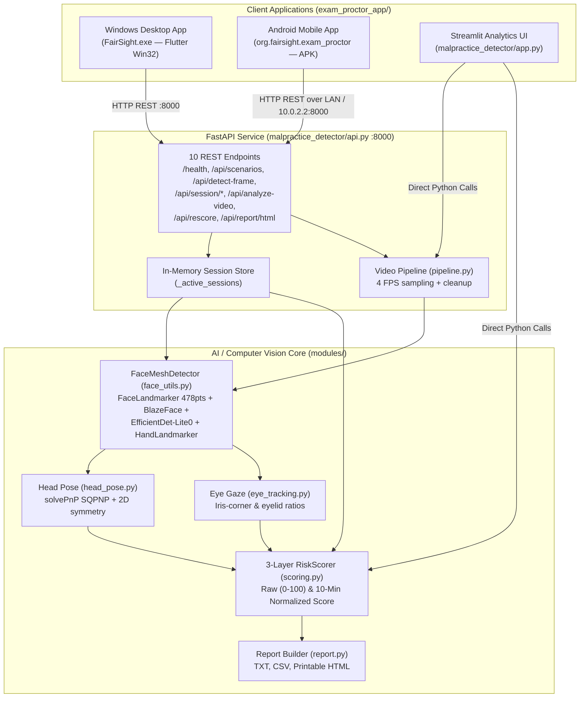
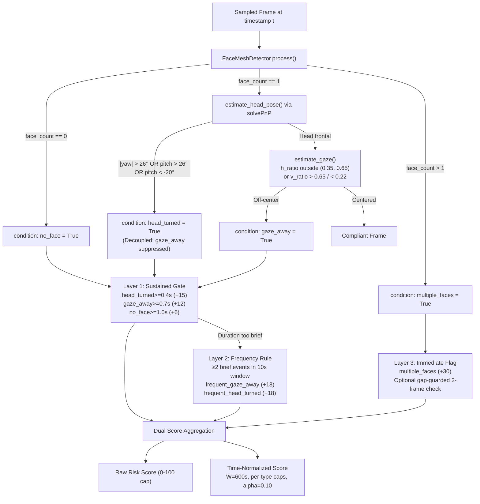
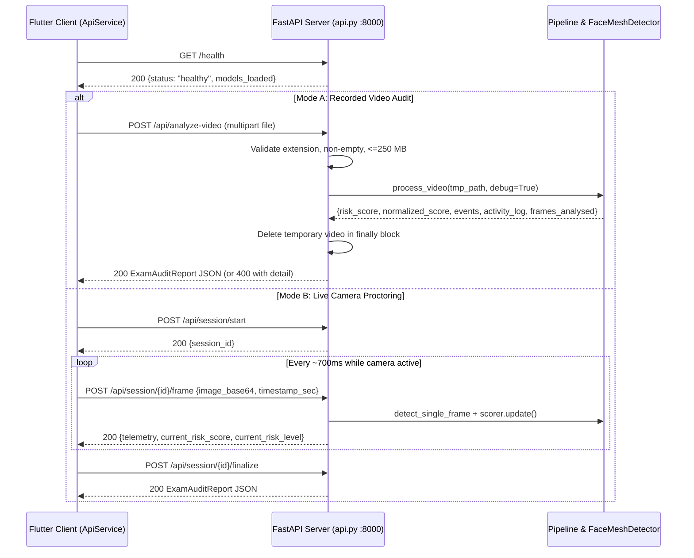
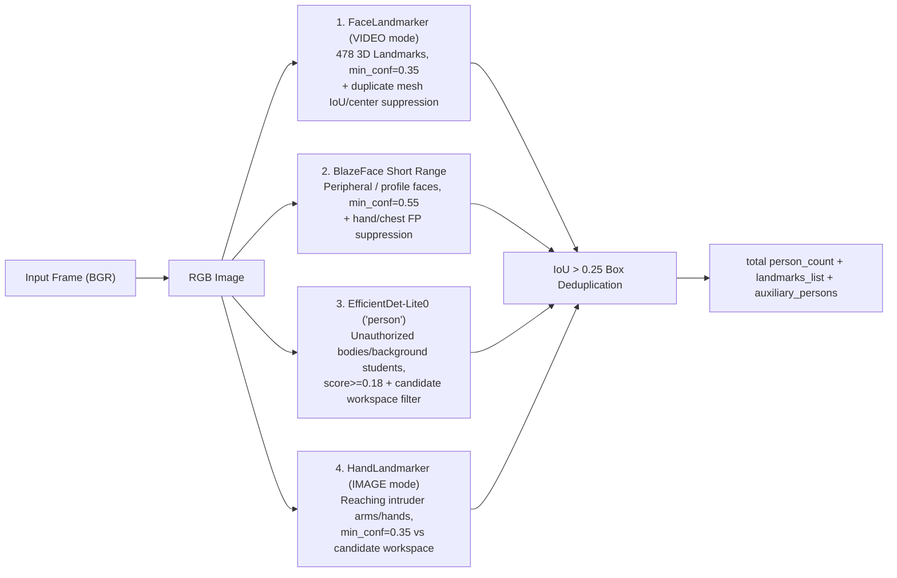
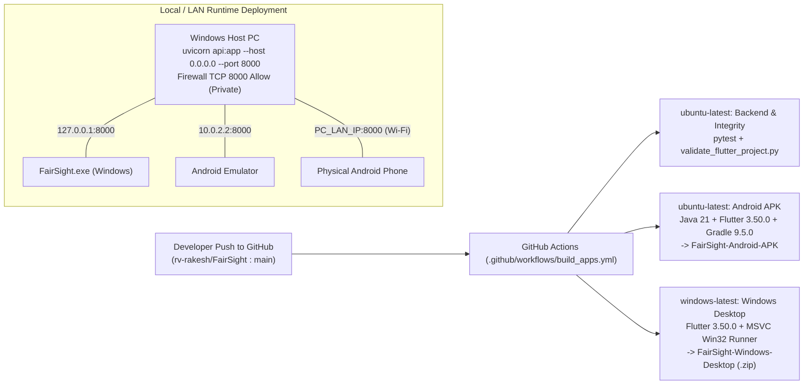

# FairSight — Architecture, System Diagrams & Presentation Reference

> Every component, endpoint, threshold, and file path below reflects the verified implementation in `fairsight_src/`.

---

## 1. Overall System Architecture

---

## 2. Data Flow Diagram (DFD)

```mermaid
flowchart LR
    U["Invigilator / Candidate"] -->|"Video (.mp4/.avi/.mov/.mkv/.webm)<br/>or Live Base64 Camera Frame"| API["FastAPI Ingress<br/>(api.py validation)"]
    API -->|"Valid Decoded BGR Frame(s)"| CV["OpenCV Frame Sampler<br/>(4 FPS / 250 ms step)"]
    CV -->|"RGB Image + Timestamp"| MP["MediaPipe Cascade<br/>(face_utils.py)"]
    MP -->|"478 Landmarks (if face_count == 1)"| GEOM["head_pose.py + eye_tracking.py<br/>(yaw, pitch, roll, gaze_h, gaze_v)"]
    MP -->|"face_count == 0 or > 1"| COND["Condition Evaluator<br/>no_face | multiple_faces"]
    GEOM -->|"Thresholds from scoring_config.py"| COND
    COND -->|"Per-frame conditions + details"| RS["RiskScorer<br/>(scoring.py)"]
    RS -->|"Events + Activity Log +<br/>Raw & 10m Normalized Score"| JSONOUT["JSON Audit Response /<br/>Printable HTML Certificate"]
    JSONOUT --> U
```

---

## 3. Detection & 3-Layer Scoring Workflow

---

## 4. Backend / Frontend Communication Sequence

---

## 5. API Endpoint Map

| Method | Endpoint | Purpose | Error Handling Verified |
|---|---|---|---|
| `GET` | `/health` | Service status, model asset checks, active session count | — |
| `GET` | `/api/scenarios` | Lists the 5 simulated calibration scenarios | — |
| `POST` | `/api/scenarios/{key}/run` | Runs `RiskScorer` on a benchmark scenario timeline | `404` on unknown key |
| `POST` | `/api/detect-frame` | Stateless single base64 frame telemetry | `400` bad base64/image, `422` negative timestamp |
| `POST` | `/api/session/start` | Creates a stateful session with `RiskScorer` | — |
| `POST` | `/api/session/{id}/frame` | Decodes frame, updates session scorer, returns live risk | `404` unknown session, `400`/`422` invalid timestamp |
| `POST` | `/api/session/{id}/finalize` | Finalizes session & returns raw + normalized report | `404` missing or already finalized |
| `POST` | `/api/analyze-video` | Saves upload to temp, runs 4 FPS `process_video`, cleans up | `400` empty/corrupt/unsupported, `413` >250 MB |
| `POST` | `/api/rescore` | Re-evaluates `debug_frames` with custom config in memory | `400` malformed payload |
| `POST` | `/api/report/html` | Builds HTML-escaped printable audit certificate | `400` malformed payload |

---

## 6. AI/ML Multi-Stage Detection Cascade (`modules/face_utils.py`)

---

## 7. Deployment & CI/CD Architecture

---

## 8. Concise Presentation (PPT) Bullet Reference

1. **Problem Statement**: Manual proctoring does not scale cleanly, while opaque black-box classifiers and cumulative point counters punish honest candidates during long exams.
2. **FairSight Solution**: Explainable, rule-based behavioral telemetry engine pairing MediaPipe Tasks API (Face + BlazeFace + EfficientDet-Lite0 + HandLandmarker) with OpenCV `solvePnP` head pose and iris-ratio gaze tracking.
3. **3 Key Algorithmic Innovations**:
   - *Head-Gaze Decoupling*: Suppresses `gaze_away` when `head_turned` is active to prevent double counting (`head_turned` + `gaze_away`).
   - *3-Layer Scoring Engine*: Sustained duration gates (`0.4s`/`0.7s`/`1.0s`) + rolling frequency pattern detector (`>=2` in `10s`) + immediate multi-person flag (`+30`).
   - *Windowed Time Normalization*: 10-minute windows (`W=600s`) with per-type caps and persistence factor `alpha=0.10` prevent false High-risk escalation over 3-hour exams.
4. **Engineering & Privacy Safeguards**: Temporary uploaded video files are deleted in a `finally` block; HTML certificates sanitize metadata; single `scoring_config.py` governs all parameters.
5. **Honest Scope & Limitations**: Rule weights are policy-calibrated rather than learned probabilities; local CPU throughput operates at 4 FPS sampling; no external real-student annotated dataset is claimed.
